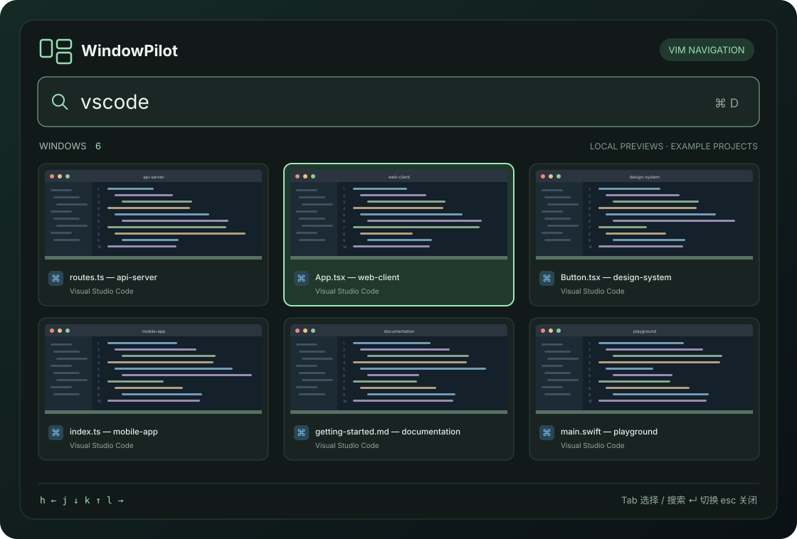

<div align="center">

# WindowPilot

### 窗口再多，也能一步找到。

一款原生 macOS 窗口搜索与切换工具。<br>
全局快捷键呼出 · 窗口缩略图 · Vim 风格导航


[](LICENSE)

[快速开始](#快速开始) · [键盘操作](#键盘操作) · [权限与隐私](#权限与隐私) · [卸载](#卸载) · [参与贡献](#参与贡献)



<sub>界面示意，使用虚构项目展示布局，不包含真实窗口截图。</sub>

</div>

## 找到窗口，而不只是找到应用

同时打开多个 VS Code 项目时，切换到 Code 并不代表找到了需要的那个窗口。WindowPilot 将各个窗口的标题和缩略图放在同一个搜索面板里，让你直接选择目标窗口。

```text
⌘D 呼出 → 输入 vscode → Tab 进入选择 → h/j/k/l 移动 → Enter 切换
```

- **全局呼出**：按 `⌘D` 打开或关闭面板，也可从菜单栏打开。
- **按窗口搜索**：匹配应用名、窗口标题和 Bundle ID；支持空格分隔的多个关键词。
- **缩略图网格**：三列展示窗口预览、标题及应用图标，方便区分同一应用的多个窗口。
- **Vim 风格导航**：用 `h/j/k/l` 或方向键选择，按 Enter 进入指定窗口。
- **VS Code 别名**：输入 `vscode`、`vs code` 或实际应用名即可搜索，兼容 VS Code Insiders。
- **原生实现**：基于 AppKit、SwiftUI、ScreenCaptureKit 和 Accessibility API，无第三方包依赖；仅“其他桌面窗口预览”使用了系统私有接口，详见[实现与边界](#实现与边界)。

## 快速开始

需要 **macOS 14 或更新版本**，以及支持 Swift 5.9+ 的 Xcode Command Line Tools。构建产物使用当前 Mac 的架构；已在 Apple Silicon 上验证。

```sh
# 尚未安装命令行工具时运行
xcode-select --install

git clone https://github.com/suhetai/WindowPilot.git
cd WindowPilot

bash test.sh
bash install.sh   # 构建，并安装到 /Applications 后打开
```

`install.sh` 会调用 `build.sh` 生成 `dist/WindowPilot.app`，替换“应用程序”文件夹中的旧版本并重新打开。只想构建而不安装时，运行 `bash build.sh`。

**本地开发建议先运行一次** `bash scripts/create-local-signing-identity.sh`。它会在登录钥匙串中创建名为 `WindowPilot Local Signing` 的自签名证书（不修改系统信任设置），此后每次构建签名一致，重新编译不必重新授权。不创建也能使用，但默认的临时签名在每次重新编译后都需要重新授权，详见[签名说明](SIGNING.md)。

WindowPilot 运行在菜单栏，不显示 Dock 图标。打开后完成下方两项权限设置，再按 `⌘D` 开始搜索。

> **快捷键占用**：运行期间，WindowPilot 会接管全局 `⌘D`，可能覆盖其他应用原有的同名快捷键。退出后恢复。当前可在 [`App.swift`](Sources/WindowPilot/App.swift) 的 `RegisterEventHotKey` 调用中修改键码和修饰键，尚无图形化配置界面。

## 键盘操作

| 按键 | 操作 |
| :--- | :--- |
| `⌘D` | 全局打开／关闭搜索面板 |
| 输入文字 | 按应用或窗口标题筛选 |
| `Tab` | 切换搜索模式与选择模式 |
| `h` / `j` / `k` / `l` | 选择模式中向左／下／上／右移动 |
| `←` / `↓` / `↑` / `→` | 移动并进入选择模式 |
| `Enter` | 切换到选中的窗口 |
| `/` 或 `i` | 选择模式中返回搜索 |
| `⌘A` | 全选搜索文字，方便替换关键词 |
| `⌘R` | 刷新窗口列表和预览 |
| `Esc` | 关闭面板并返回原应用 |

也可以点击卡片直接切换。搜索模式中的 `h/j/k/l` 正常输入文字；中文输入法组合期间的按键交由输入法处理。

## 权限与隐私

在 **系统设置 → 隐私与安全性** 中为当前安装的 WindowPilot 开启：

| 权限 | 用途 |
| :--- | :--- |
| 辅助功能 | 读取窗口信息、恢复最小化窗口并切换到指定窗口 |
| 屏幕录制／录屏与系统录音 | 获取窗口缩略图和窗口标题；应用不会录制音频 |

窗口预览只保存在进程内存中，关闭面板后释放。应用没有联网或上传逻辑，也不会将窗口截图保存到磁盘。

### 开关已开启，但功能仍不可用？

macOS 的授权与应用签名身份相关。**未创建本地签名身份时，构建使用临时签名，重新编译后旧授权会失效**，即使系统设置中的开关仍然是开的。

1. 退出 WindowPilot。
2. 在上述两项权限列表中选中旧的 WindowPilot，点击“−”移除，再添加当前安装的应用并开启权限。
3. 重新打开应用；如系统提示“退出并重新打开”，按提示操作。

经常重新编译时，建议使用固定签名身份，见[快速开始](#快速开始)和[签名说明](SIGNING.md)。本地构建的应用不会被 Gatekeeper 拦截；从网络下载、未经 Apple 公证的构建，首次打开时可能需要在“隐私与安全性”中选择“仍要打开”。

## 实现与边界

窗口列表来自系统窗口信息和 ScreenCaptureKit；窗口标题可通过 Accessibility 补充。切换时结合应用 PID、窗口标题和窗口位置匹配目标，匹配不明确时提示错误，避免随机选择同名窗口。

被其他窗口遮挡的普通窗口通常可以生成独立预览。最小化窗口没有保留画面，不显示预览；禁止截图的应用（如密码管理器）同样不显示预览。这两种情况卡片上都会注明原因。全屏应用，或对辅助功能支持不完整的应用，可能无法列出或切换。面板内按 `⌘R` 可刷新已变化的标题或已关闭的窗口。

> **关于私有接口**：ScreenCaptureKit 无法截取不在当前桌面的窗口（错误 `-3811`）。为了给这类窗口显示预览，WindowPilot 会在运行时从系统私有框架 SkyLight 中查找 `CGSHWCaptureWindowList`，读取窗口服务器保留的画面。该调用同样需要屏幕录制权限，找不到接口或读取失败时显示应用图标。私有接口没有公开文档，未来的 macOS 版本可能改变其行为；使用私有接口的应用也无法上架 Mac App Store。

出现问题时，请附上界面中的错误信息：`AX -25211` 表示系统拒绝辅助功能访问；ScreenCaptureKit `-3801` 表示系统拒绝屏幕捕获。预览不可用的详细原因，可将鼠标悬停在卡片的提示文字上查看。

## 卸载

```sh
pkill -x WindowPilot
rm -rf /Applications/WindowPilot.app
tccutil reset Accessibility dev.windowpilot.mac
tccutil reset ScreenCapture dev.windowpilot.mac
```

如果系统设置的权限列表中仍有 WindowPilot 条目，选中后点击“−”移除。创建过本地签名身份的话，可在“钥匙串访问”中删除 `WindowPilot Local Signing` 证书及其私钥。WindowPilot 本身不保存配置文件。

<details>
<summary>项目结构与验证</summary>

```text
Sources/WindowPilot/
├── App.swift                  # 菜单栏、全局快捷键、面板窗口与键盘处理
├── Interface.swift            # 搜索栏、窗口卡片、网格与选中高亮
├── WindowStore.swift          # 窗口枚举、截图、权限状态与窗口激活
├── WindowServerCapture.swift  # 其他桌面窗口的预览回退（私有接口，运行时解析）
└── WindowLogic.swift          # 关键词匹配、网格移动、窗口匹配与高亮动画
Tests/
└── WindowLogicChecks.swift
scripts/
└── create-local-signing-identity.sh  # 创建本地自签名身份
build.sh · install.sh · test.sh
```

`bash test.sh` 使用独立的 Swift 检查程序运行 26 项断言，覆盖关键词、别名、网格边界、同名窗口匹配和选中高亮动画，不依赖 XCTest。它不模拟系统权限，也不覆盖跨应用交互。

已在开发机上人工验证：六个 VS Code 窗口的标题与真实缩略图、Vim 键选择、Enter 切换到指定窗口、在 Code 中用全局 `⌘D` 呼出，以及同一签名构建重启后权限保留。其他系统版本和应用仍需更多测试。

</details>

## 参与贡献

欢迎提交 [Issue](https://github.com/suhetai/WindowPilot/issues) 和 Pull Request。报告问题时，请提供 macOS 版本、目标应用、复现步骤和错误码；附截图前，请遮挡项目代码、密钥等私人内容。

提交修改前运行 `bash test.sh` 和 `bash build.sh`。涉及窗口切换、权限或输入焦点的改动，还应在本机授权后实际验证。

## 许可证

[MIT](LICENSE) © 2026 suhetai

Apple、macOS 是 Apple Inc. 的商标；Visual Studio Code 是 Microsoft Corporation 的商标。本项目为独立开源项目，与上述公司没有关联。
